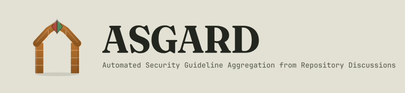

<p align="center">
  <picture>
    <source media="(prefers-color-scheme: dark)" srcset="docs/banner-dark.svg">
    
  </picture>
</p>

ASGARD (**A**utomated **S**ecurity **G**uideline **A**gent from **R**epository **D**iscussions) writes an evidence-based `SECURITY.md` from the pull request discussions of any GitHub repository. A classifier and an evaluator agree on which discussions are about security, and a synthesis step turns the approved set into the guideline.

The tool generalizes the manual pipeline from *Automatically Generating Security Guidelines from Pull Request Discussions: The Case of Django Framework* (VEM 2026) into a reproducible system for the SANER 2027 Tool Demo Track. That study showed pull request discussions carry enough evidence to produce useful security guidelines. The original run was specific to Django, processed 18,524 pull requests by hand, and finished by pasting JSON into claude.ai.

## Install

Python 3.11 or newer.

```bash
python -m venv .venv
source .venv/bin/activate
pip install -e .
```

## Credentials

Copy `.env.example` to `.env`. ASGARD reads that file on startup and never writes secrets into the saved run configuration.

| Variable | Used for |
| --- | --- |
| `GITHUB_TOKEN` | Reading the repository. A classic token needs the `repo` or `public_repo` scope. |
| `GEMINI_API_KEY` | Gemini |
| `OPENAI_API_KEY` | OpenAI |
| `ANTHROPIC_API_KEY` | Anthropic |
| `OLLAMA_HOST` | Local Ollama. Defaults to `http://localhost:11434`. |

Ollama is the free path: it needs a running daemon and a pulled model, and no API key. Gemini, OpenAI, and Anthropic each need their own key. A role can use a different provider from the default.

## Quickstart

Keep the first run small. With Ollama serving `llama3.1`:

```bash
asgard run owner/name --max-prs 10 --provider ollama --model llama3.1
```

`owner/name` may also be a `github.com` URL. The command checks that the token can see the repository and that each configured model endpoint answers, then mines, normalizes, classifies, consolidates, synthesizes the guideline, and writes `SECURITY.md`. Results land in `runs/owner__name/<utc-stamp>/`.

To continue a finished prefix of that run:

```bash
asgard run --config runs/owner__name/<utc-stamp>/config.json --from classify
```

`--from` accepts `mine`, `normalize`, `classify`, `consolidate`, `synthesize`, or `security_md`. Every earlier stage must already have written its output.

Consolidation does not call a model. It joins the classify summary, the normalized pull requests, and `classify/trace.jsonl`, then writes three files:

- `consolidate/output.json` is the list synthesis will read. By default each item is an approved pull request whose final classification has a security discussion: `pr_id`, `title`, `link` (`https://github.com/{repository}/pull/{pr_id}`), `evidence` (`quote` and `location`), and `rationale`.
- `consolidate/audit.jsonl` has one line per pull request, in classify order: `pr_id`, `decision`, `status`, `iterations`, `trace` (`classify/trace.jsonl`), and `trace_lines`.
- `consolidate/summary.json` has `total`, `security`, `non_security`, and `unresolved`. Those three counts add up to `total`.

`--include-unresolved` also sends unresolved and errored pull requests into that list when their final classification still has a security discussion. An error with no valid classification stays out. Approved pull requests without a security discussion stay out either way.

Synthesis reads `consolidate/output.json` and writes the User Guideline to `synthesize/output.json`. One model call receives the whole list. Each recommendation cites pull requests from that list as `#123`. When the list is empty, the stage skips the model and writes a sentence: there was no security discussion, so there is no guideline.

The next stage writes `<run>/SECURITY.md`. Each citation written as `(#123)` or `(#123, #456)` becomes a link to `https://github.com/<owner>/<repo>/pull/123`. A hash that is part of the prose, such as PKCS #1, stays text. A footer records the ASGARD version, the UTC date, the repository, the model used for each role, how many pull requests were analysed, and how many security pull requests were used. A citation outside that approved set stays linked and is reported: one `CitationWarning` event, and the id in `security_md/output.json` under `unknown_citations`. `--security-md` writes the file somewhere else.

## Configuration

Settings can live in a TOML or JSON file passed with `--config`. Flags override the file. Omitted settings keep the file value.

```toml
repo = "owner/name"
max_iterations = 3

[filters]
state = "all"
since = "2024-01-01"
max_prs = 10

[llm.default]
provider = "ollama"
model = "llama3.1"

[llm.evaluator]
model = "llama3.1"
```

`max_iterations` is the cap on classifier–evaluator rounds for one pull request (default 3). A role block inherits `provider` and `model` from `[llm.default]` when it omits them. Each role also accepts `temperature` (default `0`) and `timeout` in seconds (default `300`). The roles are `classifier`, `evaluator`, and `synthesizer`.

The miner keeps pull requests by `state` (`open`, `closed`, or `all`), `since`, `until` (`YYYY-MM-DD`), and `max_prs`.

| Flag | Effect |
| --- | --- |
| `repo` | `owner/name` or a github.com URL |
| `--config` | TOML or JSON settings file |
| `--from` | Resume at `mine`, `normalize`, `classify`, `consolidate`, `synthesize`, or `security_md` |
| `--security-md` | Where to write `SECURITY.md`. Default: `<run>/SECURITY.md` |
| `--include-unresolved` | Also send unresolved and errored security discussions to synthesis |
| `--output-dir` | Run directory. Default: `runs/<owner>__<name>/<utc-stamp>` |
| `--max-iterations` | Classifier–evaluator rounds per pull request |
| `--state` | `open`, `closed`, or `all` |
| `--since`, `--until` | Creation-date bounds |
| `--max-prs` | Stop after this many pull requests |
| `--provider`, `--model` | Default model |
| `--classifier-provider`, `--classifier-model` | Classifier override |
| `--evaluator-provider`, `--evaluator-model` | Evaluator override |
| `--synthesizer-provider`, `--synthesizer-model` | Synthesizer override |

`--prefilter`, `--merged-only`, and `--label` are stored on the run configuration for stages that are still ahead.

## Development

```bash
pip install -e ".[dev]"
pytest
```

The default test run skips live provider calls (`-m "not smoke"`).

## License

[MIT](LICENSE)
