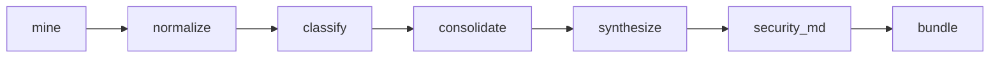

<p align="center">
  <picture>
    <source media="(prefers-color-scheme: dark)" srcset="docs/banner-dark.svg">
    
  </picture>
</p>

ASGARD (**A**utomated **S**ecurity **G**uideline **A**gent from **R**epository **D**iscussions) writes an evidence-based `SECURITY.md` from the pull request discussions of any GitHub repository. A classifier and an evaluator agree on which discussions are about security, and a synthesis step turns the approved set into the guideline.

The tool generalizes the manual pipeline from *Automatically Generating Security Guidelines from Pull Request Discussions: The Case of Django Framework* (VEM 2026) into a reproducible system for the SANER 2027 Tool Demo Track. That study showed pull request discussions carry enough evidence to produce useful security guidelines. The original run was specific to Django, processed 18,524 pull requests by hand, and finished by pasting JSON into claude.ai.

## Pipeline



| Stage | What it writes |
| --- | --- |
| `mine` | One JSON file per pull request |
| `normalize` | One record per pull request, ready for the models |
| `classify` | A classifier–evaluator decision for each pull request |
| `consolidate` | The approved security discussions |
| `synthesize` | The user guideline |
| `security_md` | `SECURITY.md` |
| `bundle` | `manifest.json` |

## Install

Python 3.11 or newer. The commands below assume this virtual environment is active.

```bash
python -m venv .venv
source .venv/bin/activate
pip install -e .
```

The spreadsheet export needs openpyxl. Install it with the export extra when you want `asgard export` or `--export-xlsx`:

```bash
pip install -e ".[export]"
```

## Credentials

Copy `.env.example` to `.env`. ASGARD reads that file on startup and never writes secrets into the saved run configuration.

Create a classic personal access token at [github.com/settings/tokens](https://github.com/settings/tokens). A public repository needs the `public_repo` scope. A private repository needs `repo`. Put that token in `GITHUB_TOKEN`.

| Variable | Used for |
| --- | --- |
| `GITHUB_TOKEN` | Reading the repository. A classic token needs the `repo` or `public_repo` scope. |
| `GEMINI_API_KEY` | Gemini |
| `OPENAI_API_KEY` | OpenAI |
| `ANTHROPIC_API_KEY` | Anthropic |
| `OLLAMA_HOST` | Local Ollama. Defaults to `http://localhost:11434`. |

Ollama is the free path: it needs a running daemon and a pulled model, and no API key. Gemini, OpenAI, and Anthropic each need their own key. A role can use a different provider from the default.

For the free path, install [Ollama](https://ollama.com), pull a model, and leave the daemon running:

```bash
ollama pull llama3.1
```

## Quickstart

Keep the first run small. With Ollama serving `llama3.1`:

```bash
asgard run owner/name --max-prs 10 --provider ollama --model llama3.1
```

`owner/name` may also be a `github.com` URL. The same command works with `--provider gemini`, `--provider openai`, or `--provider anthropic` once that provider's key is in `.env`. The command checks that the token can see the repository and that each configured model endpoint answers, then mines, normalizes, classifies, consolidates, synthesizes the guideline, writes `SECURITY.md`, and writes a run manifest. Results land in `runs/owner__name/<utc-stamp>/`. Open `runs/owner__name/<utc-stamp>/SECURITY.md`.

The same settings can live in `asgard.toml`. Flags override the file.

```bash
asgard run --config asgard.toml
```

To continue a finished prefix of that run:

```bash
asgard run --config runs/owner__name/<utc-stamp>/config.json --from classify
```

`--from` accepts `mine`, `normalize`, `classify`, `consolidate`, `synthesize`, `security_md`, or `bundle`. Every earlier stage must already have written its output. `--only` runs that one stage and stops, with the same requirement. The two flags cannot be combined.

Progress goes to stderr. `--quiet` hides it. `--json-logs` writes one JSON event per line to stdout, and the two can be used together. The command exits 0 when it finishes, 2 when the settings or the requested stage are invalid, and 1 when the pipeline fails for another reason.

`asgard export <run-dir>` writes `bundle/classifications.xlsx` from `classify/output.json`. It does not call a model and it does not rewrite the manifest.

## Configuration

Settings can live in a TOML or JSON file passed with `--config`. Flags override the file. Omitted settings keep the file value. Save this as `asgard.toml` for a small run:

```toml
repo = "owner/name"
max_iterations = 3
batch_size = 1
include_unresolved = false
export_xlsx = false

[filters]
state = "all"
since = "2024-01-01"
until = "2024-12-31"
max_prs = 10

[llm.default]
provider = "ollama"
model = "llama3.1"
temperature = 0
timeout = 300

[llm.classifier]
model = "llama3.1"

[llm.evaluator]
model = "llama3.1"

[llm.synthesizer]
model = "llama3.1"
```

`max_iterations` is the cap on classifier–evaluator rounds for one pull request (default 3). `batch_size` is how many still-active pull requests the classifier judges in one call, and how many the evaluator judges in one call (default 1). `batch_max_chars`, when set, closes a batch before `batch_size` if the next pull request would pass that many characters. A pull request larger than the cap is sent alone. A role block inherits `provider` and `model` from `[llm.default]` when it omits them. Each role also accepts `temperature` (default `0`) and `timeout` in seconds (default `300`). The roles are `classifier`, `evaluator`, and `synthesizer`.

The miner keeps pull requests by `state` (`open`, `closed`, or `all`), `since`, `until` (`YYYY-MM-DD`), and `max_prs`.

| Flag | Effect |
| --- | --- |
| `repo` | `owner/name` or a github.com URL |
| `--config` | TOML or JSON settings file |
| `--from` | Resume at `mine`, `normalize`, `classify`, `consolidate`, `synthesize`, `security_md`, or `bundle` |
| `--only` | Run that one stage. Earlier stages must already be done |
| `--quiet` | Hide the progress bar |
| `--json-logs` | Write one JSON event per line to stdout |
| `--security-md` | Where to write `SECURITY.md`. Default: `<run>/SECURITY.md` |
| `--include-unresolved` | Also send unresolved and errored security discussions to synthesis |
| `--export-xlsx` | Write `bundle/classifications.xlsx`. Off unless set |
| `--output-dir` | Run directory. Default: `runs/<owner>__<name>/<utc-stamp>` |
| `--max-iterations` | Classifier–evaluator rounds per pull request |
| `--batch-size` | Pull requests per classifier or evaluator call. Default 1 |
| `--batch-max-chars` | Character cap for one batch. A larger single pull request still goes alone |
| `--state` | `open`, `closed`, or `all` |
| `--since`, `--until` | Creation-date bounds |
| `--max-prs` | Stop after this many pull requests |
| `--provider`, `--model` | Default model |
| `--classifier-provider`, `--classifier-model` | Classifier override |
| `--evaluator-provider`, `--evaluator-model` | Evaluator override |
| `--synthesizer-provider`, `--synthesizer-model` | Synthesizer override |

`--prefilter`, `--merged-only`, and `--label` are stored on the run configuration for stages that are still ahead. Repeat `--label` to record several labels.

## Run directory

A run is one directory. The default path is `runs/<owner>__<name>/<utc-stamp>/`.

```text
runs/owner__name/20260101T120000Z/
  config.json
  events.jsonl
  SECURITY.md
  manifest.json
  mine/
    output.json
    prs/123.json
  normalize/
    output.json
    items.jsonl
  classify/
    output.json
    items.jsonl
    trace.jsonl
    metrics.json
  consolidate/
    output.json
    audit.jsonl
    summary.json
  synthesize/
    output.json
  security_md/
    output.json
  bundle/
    output.json
    classifications.xlsx
```

`config.json` is the saved settings with secrets removed. `events.jsonl` is one progress event per line. `asgard logs <run-dir>` prints that file grouped by stage. It does not call a model. `--stage` limits the view to one stage. `--follow` keeps reading new lines until interrupted. During classify, a batched run shows the batch (`batch 2/12`) and a one-pull-request run shows the pull request (`pr 15/200`).

```bash
asgard logs runs/owner__name/<utc-stamp>
asgard logs runs/owner__name/<utc-stamp> --stage classify
asgard logs runs/owner__name/<utc-stamp> --follow
```

`classifications.xlsx` appears only when `--export-xlsx` is set or when you run `asgard export` on this directory.

Consolidation does not call a model. It joins the classify summary, the normalized pull requests, and `classify/trace.jsonl`, then writes three files:

- `consolidate/output.json` is the list synthesis will read. By default each item is an approved pull request whose final classification has a security discussion: `pr_id`, `title`, `link` (`https://github.com/{repository}/pull/{pr_id}`), `evidence` (`quote` and `location`), and `rationale`.
- `consolidate/audit.jsonl` has one line per pull request, in classify order: `pr_id`, `decision`, `status`, `iterations`, `trace` (`classify/trace.jsonl`), and `trace_lines`.
- `consolidate/summary.json` has `total`, `security`, `non_security`, and `unresolved`. Those three counts add up to `total`.

`--include-unresolved` also sends unresolved and errored pull requests into that list when their final classification still has a security discussion. An error with no valid classification stays out. Approved pull requests without a security discussion stay out either way.

Synthesis reads `consolidate/output.json` and writes the User Guideline to `synthesize/output.json`. One model call receives the whole list. Each recommendation cites pull requests from that list as `#123`. When the list is empty, the stage skips the model and writes a sentence: there was no security discussion, so there is no guideline.

The next stage writes `<run>/SECURITY.md`. Each citation written as `(#123)` or `(#123, #456)` becomes a link to `https://github.com/<owner>/<repo>/pull/123`. A hash that is part of the prose, such as PKCS #1, stays text. A footer records the ASGARD version, the UTC date, the repository, the model used for each role, how many pull requests were analysed, and how many security pull requests were used. A citation outside that approved set stays linked and is reported: one `CitationWarning` event, and the id in `security_md/output.json` under `unknown_citations`. `--security-md` writes the file somewhere else.

## manifest.json

The last stage writes `<run>/manifest.json`, and the same document to `bundle/output.json`.

| Field | Contents |
| --- | --- |
| `version` | ASGARD package version |
| `commit` | Git commit of this checkout, or null |
| `config` | Saved settings with secrets removed |
| `prompts` | SHA-256 of each role's system prompt. The synthesizer hash is taken after `{repository}` is filled in |
| `models` | `provider` and `model` for `classifier`, `evaluator`, and `synthesizer` |
| `counts` | `mined`, `filtered`, `security`, `non_security`, and `unresolved` |
| `stages` | For each stage: `items`, `duration_s`, and `skipped` |
| `tokens` | `input` and `output` totals from `classify/trace.jsonl` |
| `cost` | Always null |
| `loop` | The contents of `classify/metrics.json`: `approval_rate_iteration_1`, `approval_rate_final`, `mean_iterations`, and `decision_flips` |
| `citation_warnings` | Pull request ids cited outside the approved set |
| `files` | Every path in the run directory, mapped to a one-line description |

Durations come from the `at` timestamp on each progress event.

## Synthesis prompt

The synthesis instructions are `SYSTEM_PROMPT` in [`asgard/prompts/synthesizer.py`](asgard/prompts/synthesizer.py). `{repository}` is replaced with `owner/name` before the call. The user message is the JSON in `consolidate/output.json` and is not part of that prompt.

Edit `SYSTEM_PROMPT` to change the guideline. Keep the response shape the stage reads: a `topics` list, each topic with `title` and `recommendations`, and each recommendation with `title`, `text`, and a non-empty `pr_ids` list. Every `pr_id` has to be one of the ids in the consolidated list. Then rerun synthesis and the stages after it:

```bash
asgard run --config runs/owner__name/<utc-stamp>/config.json --from synthesize
```

The new `manifest.json` records the SHA-256 of the edited prompt under `prompts.synthesizer`. The classifier and evaluator prompts are the constants in `asgard/prompts/classifier.py` and `asgard/prompts/evaluator.py`.

## Development

```bash
pip install -e ".[dev]"
pytest
```

The default test run skips live provider calls (`-m "not smoke"`).

## License

[MIT](LICENSE)
